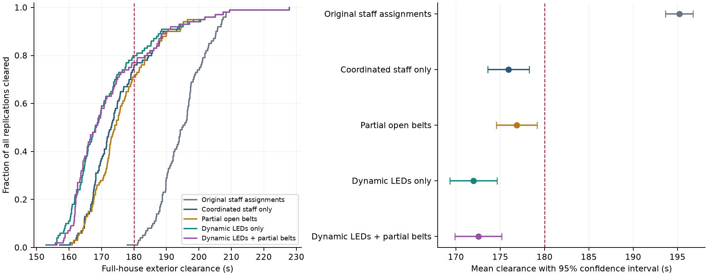
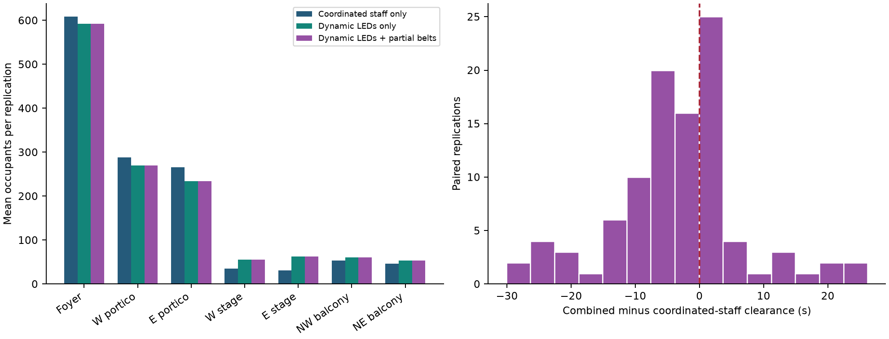

# Literature-based LED and open-barrier Monte Carlo study

Engine 1.3.0; 5 fixed policies × 100 replications, seeds 5001–5100. All policies use 1,329 occupants, the same audience distributions and six managers. The combination selected before validation is **Dynamic LEDs + partial belts**.

## Confirmatory results

| Policy | Completed / 100 | Mean (s) | SD (s) | 95% CI for mean (s) | ≤180 s |
| --- | ---: | ---: | ---: | ---: | ---: |
| Original staff assignments | 100 | 195.2 | 7.9 | 193.6–196.8 | 1/100 |
| Coordinated staff only | 100 | 175.9 | 11.9 | 173.6–178.3 | 76/100 |
| Partial open belts | 100 | 176.9 | 11.6 | 174.6–179.2 | 71/100 |
| Dynamic LEDs only | 100 | 172.0 | 13.4 | 169.3–174.6 | 80/100 |
| Dynamic LEDs + partial belts | 100 | 172.5 | 13.4 | 169.9–175.2 | 77/100 |

An unconditional mean is suppressed whenever a run remains unfinished at 900 s. Confidence intervals use Student t with 99 degrees of freedom and quantify Monte Carlo sampling uncertainty under this fixed model, not physical or parameter uncertainty. They are nominal intervals without multiplicity adjustment. The success count is a separate criterion from the mean.

## Paired effects

| Difference (negative is faster) | Complete pairs | Mean difference (s) | 95% CI (s) |
| --- | ---: | ---: | ---: |
| Dynamic LEDs only minus Coordinated staff only | 100 | -3.9 | -6.1 to -1.8 |
| Partial open belts minus Coordinated staff only | 100 | 0.9 | -0.2 to 2.1 |
| Dynamic LEDs + partial belts minus Dynamic LEDs only | 100 | 0.5 | -0.4 to 1.5 |
| Dynamic LEDs + partial belts minus Partial open belts | 100 | -4.3 | -6.5 to -2.2 |
| Dynamic LEDs + partial belts minus Coordinated staff only | 100 | -3.4 | -5.4 to -1.4 |
| Coordinated staff only minus Original staff assignments | 100 | -19.3 | -21.6 to -16.9 |

Factorial interaction (combined − LEDs − barriers + coordinated staff): -0.4 s; 95% CI -1.9 to 1.1 s. An effect conditional on completed pairs is not an unconditional effect if any pair is censored.

## Interpretation

Changing the six managers' messages changes mean clearance by -19.3 s relative to the original messages. Adding dynamic LEDs to coordinated staff changes it by -3.9 s. These comparisons use the same corrected engine and separate staffing information from the device effects.

Adding partial belts to the LED layout changes mean clearance by 0.5 s (paired 95% CI -0.4 to 1.5 s). The interval includes zero: the study does not establish an incremental belt benefit, and this is not proof of equivalence.

The slower-response sensitivity and time-step differences must be considered alongside the main result. The 180-second criterion is conditional on the reference audience and prompt response assumptions, not a demonstrated property of the real hall.

## What changed and what stayed fixed

- Corrected continuous lanes across divided rear stairs and stepped cross-aisles; existing traffic can drain lanes closed to new admissions. Opposite gate faces retain distinct queues sharing the same total gate capacity.
- A moving occupant changes destination on new guidance only for a locally estimated improvement of at least 8 s or a known infeasible current route. Final exterior crossings are committed. Individual preferences and compliance are not redrawn.
- The coordinated six-manager case changes CM2, CM3, CM5 and CM6 messages to the foyer. Posts, activation timing, hearing and acceptance distributions remain fixed. CM1 and CM4 retain portico recommendations.
- Sixteen public LED strips occupy existing walks; activation 3 s, view range 8 m, detection 0.77, acceptance 0.80. Dynamic route changes retain 5 s total observation delay, an 8 s improvement margin and a 20 s message hold.
- Belts are low/open and introduce no opaque surfaces. Partial candidates are 1 m long at 30 degrees on corridor-3 and corridor-8: projected span 0.5 m, bypass 1.9 m, and three lanes instead of four. Full-partition alternatives span the same 2.4 m corridors and close those connections. No exit threshold is occupied.
- Population, body sizes, age/speed/response distributions, row counts, door widths, physical service rules, accessibility and assistance rules are unchanged in the main comparisons. Barriers never receive a capacity bonus.

## Accessibility, waiting and crowding

| Policy | Wheelchair exterior / 300 | Wheelchair street / 300 | Mean person queue wait (s) | Mean dense person-seconds |
| --- | ---: | ---: | ---: | ---: |
| Original staff assignments | 300 | 300 | 47.9 | 39212 |
| Coordinated staff only | 300 | 300 | 35.4 | 24712 |
| Partial open belts | 300 | 300 | 35.6 | 24889 |
| Dynamic LEDs only | 300 | 300 | 33.0 | 24019 |
| Dynamic LEDs + partial belts | 300 | 300 | 33.1 | 24069 |

Dense person-seconds sum occupancy × sampled duration on links above 2 persons/m². This is a network crowding indicator, not injury risk. Accessible street arrival includes the unchanged two-team assistance model.

## Selection, reproducibility and limits

Selection was recorded in [the frozen selection record](../results/intervention-selection.json) before any confirmatory audience was evaluated. Pilot seeds 3001–3020 are separate from validation seeds 5001–5100. All exploratory attempts, including slower designs and algorithm diagnostics, are preserved. The first baseline comparison changes manager messages; the factorial comparisons hold them fixed.

Source fingerprint: `610e6dbeb123b0bc8879e64a04b10e2f73860a11177cb64b95080e2d326d823e`. Batch wall time: 22.7 minutes.

The initial 100-run study used engine 1.0.0 and is not the control arm for these interventions: it contained the documented lane and late-guidance defects. Its original data and source archive remain preserved.

The reconstructed widths, row allocation, visibility, behavior and assistance assumptions are not calibrated against a Bailey Hall evacuation. An improved simulated mean is not an operational safety guarantee. Parameter sensitivities and numerical refinement are reported separately.

[Evidence review](research/intervention-evidence.md) · [Development history](research/development-history.md) · [Per-run CSV](../results/intervention-confirmation/replications.csv) · [Machine-readable summary](../results/intervention-confirmation/summary.json) · [Statistical contrasts](../results/intervention-confirmation/analysis.json)

<!-- GENERATED VALIDATION -->
## Numerical refinement

Only the integration interval changes; the audience and selected combined layout are fixed. These seeds overlap the first three confirmatory audiences and are not additional independent evidence for policy selection.

| Seed | 0.1 s step: clearance (s) | 0.0125 s step: clearance (s) | Fine − coarse (s) |
| --- | ---: | ---: | ---: |
| 5001 | 168.9 | 164.8 | -4.1 |
| 5002 | 168.5 | 187.6 | 19.1 |
| 5003 | 187.8 | 185.0 | -2.8 |

The full network exhibits material numerical sensitivity: route decisions and lane-request ordering can change discontinuously. These three pairs do not establish time-step convergence. Isolated saturated-gate tests verify the prescribed throughput at both intervals, but that does not imply a converged full-house clearance estimate. The 0.1 s reference is retained regardless of whether refinement is faster or slower. Monte Carlo confidence intervals exclude this numerical uncertainty.

## Parameter sensitivities

These use 20 fresh audiences per policy, seeds 6001–6020, with matched audiences within each pair. The selected layout remains frozen. Lower guidance changes staff acceptance from 0.85 to 0.70, LED detection from 0.77 to 0.60, and LED acceptance from 0.80 to 0.60. Slower response changes recognition/preparation medians from 6/14 s to 10/30 s. These are declared stress cases, not calibrated probabilities or retuning.

| Sensitivity policy | Complete / 20 | Mean clearance (s) | ≤180 s |
| --- | ---: | ---: | ---: |
| Combined, nominal guidance | 20/20 | 175.4 | 13/20 |
| Combined, weaker guidance | 20/20 | 175.9 | 12/20 |
| Original staff, slower response | 20/20 | 259.1 | 0/20 |
| Combined, slower response | 20/20 | 258.8 | 0/20 |

Weaker guidance minus nominal guidance: paired mean difference 0.5 s over 20 complete pairs. Student-t 95% interval: -6.8 to 7.8 s.

Combined minus original staff under slower response: paired mean difference -0.3 s over 20 complete pairs. Student-t 95% interval: -3.4 to 2.8 s.

The slow-response tail is visible in individual records: in seed 6008, the last occupant has a sampled preparation delay of 301.8 s and crosses outside at 352.8 s; in seed 6020 the corresponding delay is 312.9 s and clearance is 349.3 s. These are model draws, not observed people. No response-tail truncation was introduced to force the benchmark, and neither last occupant changes destination after the initial choice in these records.

[Tail diagnostics](../results/intervention-response/tail-diagnostics.json) retain the sampled values and route events.

## Verification and audit

- 49 engine tests passed; 4 browser tests passed; TypeScript and production build passed.
- All 500 confirmatory archives were checked against their hashes and crossing events; 100 distinct initial audiences were paired identically across policies.
- Full results were reproduced exactly for the first seed of each of the 5 confirmatory policies.
- All six refinement and 80 sensitivity archives were audited, including a full replay of the first seed of every policy.
- Every run checks population, storage, valid transitions and wheelchair routing. All layouts preserve sightlines and accessible connectivity in the reconstructed geometry.

Physical implementation validation remains limited to the declared queue-network rules and supplied plans. No measured Bailey evacuation or surveyed usable widths were available. External crowd spillback, continuous body interactions and assistance-team travel are not represented. These omissions and the numerical sensitivity prevent treating a mean below 180 s as an operational guarantee.
