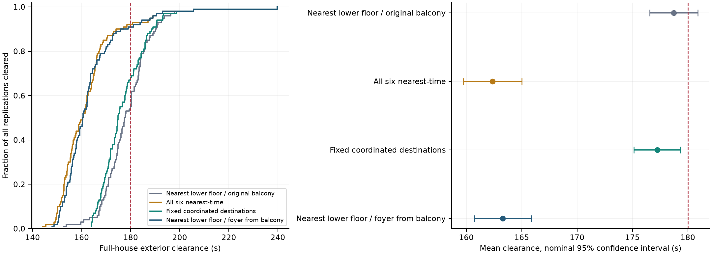

# Crowd Manager message-policy Monte Carlo comparison

Engine 1.4.0; 4 policies × 100 replications, seeds 8001–8100.

**Selected policy: Nearest-time from all six managers.** Lowest observed unconditional mean among fully completed policies.

Six staff posts, 1,329 audience members, physical parameters, age/response distributions and compliance are held fixed. No added LEDs or barriers are used. Every policy enables the same final-40/10-second rule. Only the public manager messages differ. Fresh audiences are sampled across seeds and paired identically across policies.

| Policy | Completed | Mean (s) | SD (s) | 95% CI for mean (s) | ≤180 s | p95 (s) |
| --- | ---: | ---: | ---: | ---: | ---: | ---: |
| Nearest-time lower floor; original balcony exits | 100/100 | 178.7 | 10.9 | 176.6 to 180.9 | 55/100 | 193.0 |
| Nearest-time from all six managers | 100/100 | 162.4 | 13.3 | 159.7 to 165.0 | 92/100 | 188.0 |
| Fixed coordinated destinations | 100/100 | 177.2 | 10.6 | 175.1 to 179.3 | 68/100 | 193.1 |
| Nearest-time lower floor; foyer from balcony | 100/100 | 163.3 | 13.0 | 160.7 to 165.9 | 91/100 | 188.0 |

Censored runs remain in the success denominator and prevent an unconditional mean. Quantiles are completed-only if any run is censored. Mean intervals describe sampling variation under this fixed model, not uncertainty in geometry or behaviour.

## Paired comparisons

| Difference (negative is faster) | Mean (s) | Nominal 95% interval | Simultaneous 95% interval |
| --- | ---: | ---: | ---: |
| Nearest-time lower floor; original balcony exits minus Nearest-time from all six managers | 16.4 | 14.4 to 18.4 | 13.7 to 19.1 |
| Nearest-time lower floor; original balcony exits minus Fixed coordinated destinations | 1.5 | -0.5 to 3.5 | -1.2 to 4.2 |
| Nearest-time lower floor; original balcony exits minus Nearest-time lower floor; foyer from balcony | 15.4 | 13.4 to 17.5 | 12.7 to 18.2 |
| Nearest-time from all six managers minus Fixed coordinated destinations | -14.9 | -16.9 to -12.8 | -17.7 to -12.1 |
| Nearest-time from all six managers minus Nearest-time lower floor; foyer from balcony | -0.9 | -2.0 to 0.1 | -2.4 to 0.5 |
| Fixed coordinated destinations minus Nearest-time lower floor; foyer from balcony | 13.9 | 12.0 to 15.9 | 11.2 to 16.6 |

The simultaneous intervals use Bonferroni correction across all 6 candidate contrasts. If either member is censored, that pair is omitted and the contrast is explicitly conditional. Selecting a policy from this comparison is not an independent validation of the selected minimum.

## Selected instructions

| Manager | Model post | Instruction |
| --- | --- | --- |
| CM1 | `m1` | Nearest known reachable exit by estimated travel time |
| CM2 | `m4` | Nearest known reachable exit by estimated travel time |
| CM3 | `m8` | Nearest known reachable exit by estimated travel time |
| CM4 | `m11` | Nearest known reachable exit by estimated travel time |
| CM5 | `b4` | Nearest known reachable exit by estimated travel time |
| CM6 | `b8` | Nearest known reachable exit by estimated travel time |

The selected mean's simultaneous 95% interval, adjusted across the four candidate means, is 159.0 to 165.7 s. This additional interval accounts for inspecting multiple candidate means; physical and parameter uncertainties remain excluded.

Nearest-time guidance keeps a single public instruction. Listeners evaluate known feasible routes using their current position and visible queues; managers do not periodically switch public destinations in response to congestion. The foyer-directed balcony variant is statistically close to the all-nearest variant; the adjusted interval for their paired difference includes zero. A selected sample minimum is not a proven unique optimum.

## Real-world interpretation

These are simulated message assignments, not surveyed standing positions or an approved emergency procedure. Staff must stand clear of doorway swings and moving queues. A foyer instruction on the balcony means the appropriate rear stair route, not a direct level path; staff wording and any existing signs must be consistent. Do not add corridor belts on the basis of this study. The earlier placement review remains applicable.

A nearest-time instruction requires each listener to interpret a generic rule using known routes and visible queues; it does not validate human estimates of remaining travel time. Fixed destination assignments are easier to turn into a common public message, but their actual audibility, comprehension and route access still need venue review. No staff-body obstruction, smoke or external landing spillback is represented. The final-occupant rule is a user assumption, not empirical calibration.

## Evidence and reproducibility

The design and configuration hashes were saved before the runs. Each policy directory retains full compressed event logs, per-run CSV/JSON, fixed configuration, source fingerprint and hash/replay audit. Paired audience hashes and identical staff activation times are checked before generating this report. The archived engine source preserves the evaluated implementation.

[Frozen design](../results/manager-policy-study/design.json) · [Analysis](../results/manager-policy-study/analysis.json) · [Physical placement review](research/placement-review.md)

## Executed verification

All 400 archives passed hash and crossing-count audits, with exact full-result replay of the first seed of each policy. All 741 final commitments were checked for connected routes and absence of later updates. The selected arm had 22 final commitments, including 12 exit changes, and 300/300 wheelchair-user observations reached the exterior and 300/300 reached street level within the horizon. The implementation passed 79 automated tests, 6 browser tests, TypeScript and the production build. The selected default reproduced its first-seed result completely after normalizing only the scenario title.

[Audit details](../results/manager-policy-study/policy-audit.json) · [Check record](../results/manager-policy-study/checks.json)
